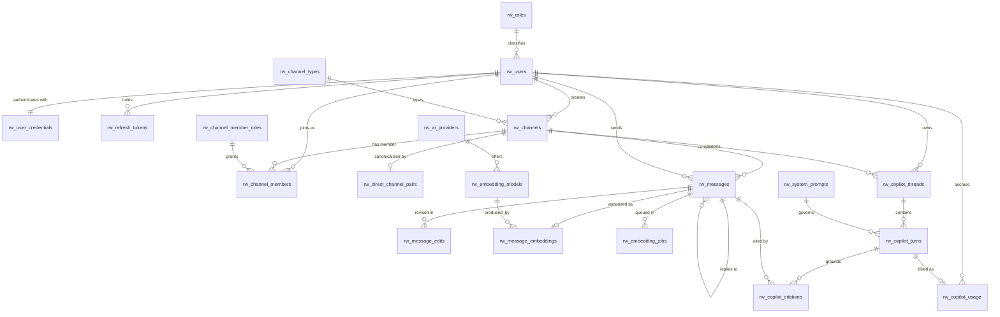

# DATA_MODEL.md — ER Model, Business Rules and Normalization

Database: `bd_juandiego_garcia_nakamoto` · Schema: `rw` · PostgreSQL 16 + `pgvector`

Naming convention (mandated): every table and every column is English and prefixed `rw_`.

---

## 1. Entity overview

20 relations, grouped by concern.

| Group | Relations |
|-------|-----------|
| Reference / lookup | `rw_roles`, `rw_channel_types`, `rw_channel_member_roles`, `rw_ai_providers`, `rw_embedding_models` |
| Identity | `rw_users`, `rw_user_credentials`, `rw_refresh_tokens` |
| Conversation | `rw_channels`, `rw_channel_members`, `rw_direct_channel_pairs` |
| Content | `rw_messages`, `rw_message_edits` |
| Retrieval | `rw_message_embeddings`, `rw_embedding_jobs` |
| Copilot | `rw_system_prompts`, `rw_copilot_threads`, `rw_copilot_turns`, `rw_copilot_citations`, `rw_copilot_usage` |

---

## 2. ER diagram

Source of truth: `docs/diagrams/er.mmd` (Mermaid). Rendered copy: `docs/diagrams/er.svg`.



---

## 3. Relations in detail

Legend: **PK** primary key · **FK** foreign key · **U** unique · **PU** partial unique index · **NN** not null.

### 3.1 `rw_roles` — system-wide role catalogue
| Column | Type | Constraints |
|--------|------|-------------|
| `rw_role_id` | `smallint` | **PK**, generated by identity |
| `rw_role_code` | `text` | **U**, **NN**, `CHECK` in (`ADMIN`,`MEMBER`) |
| `rw_role_name` | `text` | **NN** |
| `rw_description` | `text` | **NN** |

> The system role governs *administrative* capability (user administration, channel creation policy). It grants **no** content access — see IBR-01.

### 3.2 `rw_users` — people
| Column | Type | Constraints |
|--------|------|-------------|
| `rw_user_id` | `uuid` | **PK**, default `gen_random_uuid()` |
| `rw_email` | `text` | **NN**, `CHECK` shape, stored lowercase; **PU** `lower(rw_email)` `WHERE rw_is_active` |
| `rw_display_name` | `text` | **NN**, `CHECK length between 2 and 80` |
| `rw_role_id` | `smallint` | **FK** → `rw_roles` `ON DELETE RESTRICT`, **NN** |
| `rw_locale` | `text` | **NN**, default `es`, `CHECK` in (`es`,`en`) |
| `rw_avatar_url` | `text` | null |
| `rw_is_active` | `boolean` | **NN**, default `true` |
| `rw_created_at` | `timestamptz` | **NN**, default `now()` |
| `rw_updated_at` | `timestamptz` | **NN**, default `now()` (trigger-maintained) |
| `rw_last_seen_at` | `timestamptz` | null |

### 3.3 `rw_user_credentials` — secrets, isolated from the directory
| Column | Type | Constraints |
|--------|------|-------------|
| `rw_user_id` | `uuid` | **PK**, **FK** → `rw_users` `ON DELETE CASCADE` |
| `rw_password_hash` | `text` | **NN** (Argon2id encoded string) |
| `rw_password_algorithm` | `text` | **NN**, default `argon2id` |
| `rw_password_updated_at` | `timestamptz` | **NN**, default `now()` |
| `rw_failed_attempts` | `integer` | **NN**, default `0`, `CHECK >= 0` |
| `rw_locked_until` | `timestamptz` | null |

> Split from `rw_users` on purpose: the user directory must be readable by authenticated peers, the credential must be readable by **nobody** except `SECURITY DEFINER` authentication functions. Two tables make that a `GRANT` boundary instead of a column-privilege footnote. This is a *security* split, not a normalization one — the dependency `rw_user_id → rw_password_hash` is a key dependency either way.

### 3.4 `rw_refresh_tokens` — rotation ledger
| Column | Type | Constraints |
|--------|------|-------------|
| `rw_refresh_token_id` | `uuid` | **PK** |
| `rw_user_id` | `uuid` | **FK** → `rw_users` `ON DELETE CASCADE`, **NN** |
| `rw_family_id` | `uuid` | **NN** |
| `rw_token_hash` | `bytea` | **U**, **NN** (SHA-256 of the opaque token; plaintext never stored) |
| `rw_issued_at` | `timestamptz` | **NN**, default `now()` |
| `rw_expires_at` | `timestamptz` | **NN**, `CHECK rw_expires_at > rw_issued_at` |
| `rw_revoked_at` | `timestamptz` | null |
| `rw_revoked_reason` | `text` | null, `CHECK` in (`ROTATED`,`LOGOUT`,`REUSE_DETECTED`,`EXPIRED`) |
| `rw_replaced_by_token_id` | `uuid` | **FK** → self `ON DELETE SET NULL` |
| `rw_user_agent` | `text` | null |
| `rw_ip_address` | `inet` | null |

**PU-1**: `UNIQUE (rw_family_id) WHERE rw_revoked_at IS NULL` — at most one live token per family (BR-13).

### 3.5 `rw_channel_types`
`rw_channel_type_id smallint` **PK** · `rw_channel_type_code` **U NN** `CHECK in (PUBLIC, PRIVATE, DIRECT)` · `rw_description` **NN**

### 3.6 `rw_channels` — conversations
| Column | Type | Constraints |
|--------|------|-------------|
| `rw_channel_id` | `uuid` | **PK** |
| `rw_channel_type_id` | `smallint` | **FK** → `rw_channel_types` `ON DELETE RESTRICT`, **NN** |
| `rw_slug` | `text` | null for DIRECT; **PU** `WHERE rw_slug IS NOT NULL` |
| `rw_name` | `text` | null for DIRECT, **NN** otherwise (`CHECK` cross-column with type) |
| `rw_topic` | `text` | null |
| `rw_created_by` | `uuid` | **FK** → `rw_users` `ON DELETE RESTRICT`, **NN** |
| `rw_is_archived` | `boolean` | **NN**, default `false` |
| `rw_created_at` | `timestamptz` | **NN**, default `now()` |
| `rw_updated_at` | `timestamptz` | **NN**, default `now()` |

`CHECK`: a `DIRECT` channel has `rw_name IS NULL AND rw_slug IS NULL`; a `PUBLIC`/`PRIVATE` channel has both `NOT NULL`.

### 3.7 `rw_channel_members` — membership (the authorization spine)
| Column | Type | Constraints |
|--------|------|-------------|
| `rw_channel_id` | `uuid` | **PK**(1/2), **FK** → `rw_channels` `ON DELETE CASCADE` |
| `rw_user_id` | `uuid` | **PK**(2/2), **FK** → `rw_users` `ON DELETE CASCADE` |
| `rw_channel_member_role_id` | `smallint` | **FK** → `rw_channel_member_roles` `ON DELETE RESTRICT`, **NN** |
| `rw_joined_at` | `timestamptz` | **NN**, default `now()` |
| `rw_last_read_message_id` | `bigint` | **FK** → `rw_messages` `ON DELETE SET NULL`, null |
| `rw_is_muted` | `boolean` | **NN**, default `false` |

### 3.8 `rw_channel_member_roles`
`rw_channel_member_role_id smallint` **PK** · `rw_channel_member_role_code` **U NN** `CHECK in (OWNER, MODERATOR, MEMBER)` · `rw_description` **NN**

### 3.9 `rw_direct_channel_pairs` — canonical DM identity
| Column | Type | Constraints |
|--------|------|-------------|
| `rw_channel_id` | `uuid` | **PK**, **FK** → `rw_channels` `ON DELETE CASCADE` |
| `rw_user_id_low` | `uuid` | **FK** → `rw_users` `ON DELETE CASCADE`, **NN** |
| `rw_user_id_high` | `uuid` | **FK** → `rw_users` `ON DELETE CASCADE`, **NN** |

`CHECK rw_user_id_low < rw_user_id_high` (canonical ordering) · **U** `(rw_user_id_low, rw_user_id_high)` — enforces BR-08 without relying on application logic.

### 3.10 `rw_messages` — content
| Column | Type | Constraints |
|--------|------|-------------|
| `rw_message_id` | `bigint` | **PK**, `GENERATED ALWAYS AS IDENTITY` |
| `rw_channel_id` | `uuid` | **FK** → `rw_channels` `ON DELETE CASCADE`, **NN** |
| `rw_sender_id` | `uuid` | **FK** → `rw_users` `ON DELETE RESTRICT`, **NN** |
| `rw_parent_message_id` | `bigint` | **FK** → self `ON DELETE SET NULL`, null |
| `rw_body` | `text` | **NN**, `CHECK length(btrim(rw_body)) between 1 and 4000` |
| `rw_client_message_id` | `uuid` | **NN** — **U** `(rw_channel_id, rw_sender_id, rw_client_message_id)` (idempotent send, IBR-04) |
| `rw_is_deleted` | `boolean` | **NN**, default `false` |
| `rw_deleted_at` | `timestamptz` | null, `CHECK` consistent with `rw_is_deleted` |
| `rw_deleted_by` | `uuid` | **FK** → `rw_users` `ON DELETE RESTRICT`, null |
| `rw_edited_at` | `timestamptz` | null |
| `rw_revision` | `integer` | **NN**, default `1`, `CHECK >= 1` |
| `rw_created_at` | `timestamptz` | **NN**, default `now()` |
| `rw_search_vector` | `tsvector` | **NN**, `GENERATED ALWAYS AS (to_tsvector('spanish', rw_body)) STORED` |

Indexes: keyset `(rw_channel_id, rw_created_at DESC, rw_message_id DESC) WHERE NOT rw_is_deleted`; GIN on `rw_search_vector`; FK indexes on sender and parent.

### 3.11 `rw_message_edits` — immutable revision history
`rw_message_edit_id bigint` **PK** identity · `rw_message_id` **FK** `ON DELETE CASCADE` **NN** · `rw_previous_body text` **NN** · `rw_previous_revision integer` **NN** · `rw_edited_by uuid` **FK** `ON DELETE RESTRICT` **NN** · `rw_edited_at timestamptz` **NN** default `now()` · **U** `(rw_message_id, rw_previous_revision)`

### 3.12 `rw_ai_providers`
`rw_ai_provider_id smallint` **PK** · `rw_provider_code text` **U NN** · `rw_display_name` **NN** · `rw_is_openai_compatible boolean` **NN** · `rw_is_active boolean` **NN**

> No URLs, no keys. Endpoint and credential live in environment variables; this table only records *which* provider produced a given artifact so embeddings can be re-generated when the provider changes.

### 3.13 `rw_embedding_models`
`rw_embedding_model_id smallint` **PK** · `rw_ai_provider_id` **FK** `ON DELETE RESTRICT` **NN** · `rw_model_code text` **U NN** · `rw_dimensions integer` **NN** `CHECK = 1536` · `rw_is_active boolean` **NN**

### 3.14 `rw_message_embeddings`
`rw_message_id bigint` **PK**, **FK** → `rw_messages` `ON DELETE CASCADE` · `rw_embedding_model_id smallint` **FK** `ON DELETE RESTRICT` **NN** · `rw_embedding vector(1536)` **NN** · `rw_source_revision integer` **NN** · `rw_content_hash bytea` **NN** · `rw_created_at timestamptz` **NN**

Index: HNSW on `rw_embedding` with `vector_cosine_ops`.

### 3.15 `rw_embedding_jobs` — outbox for (re)vectorization
`rw_embedding_job_id bigint` **PK** identity · `rw_message_id` **FK** `ON DELETE CASCADE` **NN** · `rw_enqueued_at timestamptz` **NN** · `rw_processed_at timestamptz` null · `rw_attempts integer` **NN** default 0 `CHECK >= 0` · `rw_last_error text` null

Index: `(rw_enqueued_at) WHERE rw_processed_at IS NULL` (partial, hot-set only).

### 3.16 `rw_system_prompts` — versioned copilot instructions
`rw_system_prompt_id smallint` **PK** identity · `rw_prompt_version text` **U NN** · `rw_prompt_body text` **NN** · `rw_is_active boolean` **NN** default false · `rw_created_at timestamptz` **NN**

**PU-2**: `UNIQUE ((true)) WHERE rw_is_active` — exactly one active version (BR-15).

### 3.17 `rw_copilot_threads`
`rw_copilot_thread_id uuid` **PK** · `rw_user_id` **FK** `ON DELETE CASCADE` **NN** · `rw_channel_id` **FK** `ON DELETE CASCADE` null (thread may be global or channel-scoped) · `rw_title text` null · `rw_created_at`/`rw_updated_at timestamptz` **NN**

### 3.18 `rw_copilot_turns`
`rw_copilot_turn_id uuid` **PK** · `rw_copilot_thread_id` **FK** `ON DELETE CASCADE` **NN** · `rw_system_prompt_id` **FK** `ON DELETE RESTRICT` **NN** · `rw_question text` **NN** · `rw_answer text` null · `rw_answer_status text` **NN** `CHECK in (ANSWERED, INSUFFICIENT_CONTEXT, NO_PERMISSION, OUT_OF_SCOPE, PROVIDER_ERROR)` · `rw_candidate_count integer` **NN** `CHECK >= 0` · `rw_created_at timestamptz` **NN**

### 3.19 `rw_copilot_citations`
`rw_copilot_citation_id bigint` **PK** identity · `rw_copilot_turn_id` **FK** `ON DELETE CASCADE` **NN** · `rw_message_id` **FK** `ON DELETE CASCADE` **NN** · `rw_similarity real` **NN** `CHECK between -1 and 1` · `rw_rank smallint` **NN** `CHECK >= 1` · **U** `(rw_copilot_turn_id, rw_message_id)`

### 3.20 `rw_copilot_usage` — consumption ledger (source for OBJ-07)
`rw_copilot_usage_id bigint` **PK** identity · `rw_user_id` **FK** `ON DELETE CASCADE` **NN** · `rw_copilot_turn_id` **FK** `ON DELETE SET NULL` null · `rw_ai_provider_id` **FK** `ON DELETE RESTRICT` **NN** · `rw_model_code text` **NN** · `rw_operation text` **NN** `CHECK in (CHAT, EMBEDDING)` · `rw_prompt_tokens integer` **NN** `CHECK >= 0` · `rw_completion_tokens integer` **NN** `CHECK >= 0` · `rw_total_tokens integer` **NN** `CHECK >= 0` · `rw_latency_ms integer` **NN** `CHECK >= 0` · `rw_created_at timestamptz` **NN**

> A ledger, not a counter. Embedding calls consume tokens outside any copilot turn (`rw_copilot_turn_id IS NULL`), so usage cannot be a column on `rw_copilot_turns`. Aggregation happens in `rw_fn_copilot_usage_summary`.

---

## 4. Cardinalities

| Relationship | Cardinality | Optionality |
|--------------|-------------|-------------|
| `rw_roles` → `rw_users` | 1 : N | a role may have no users; a user has exactly one role |
| `rw_users` → `rw_user_credentials` | 1 : 1 | mandatory both ways |
| `rw_users` → `rw_refresh_tokens` | 1 : N | optional |
| `rw_users` → `rw_channels` (creator) | 1 : N | a channel has exactly one creator |
| `rw_channel_types` → `rw_channels` | 1 : N | a channel has exactly one type |
| `rw_users` ↔ `rw_channels` | M : N via `rw_channel_members` | a channel has ≥ 1 member (BR-10); a user may have none |
| `rw_channels` → `rw_direct_channel_pairs` | 1 : 0..1 | present only for `DIRECT` |
| `rw_channels` → `rw_messages` | 1 : N | optional |
| `rw_users` → `rw_messages` | 1 : N | a message has exactly one sender |
| `rw_messages` → `rw_messages` | 1 : N (self, thread) | optional parent |
| `rw_messages` → `rw_message_edits` | 1 : N | optional |
| `rw_messages` → `rw_message_embeddings` | 1 : 0..1 | optional (async) |
| `rw_embedding_models` → `rw_message_embeddings` | 1 : N | mandatory on the child |
| `rw_ai_providers` → `rw_embedding_models` | 1 : N | mandatory on the child |
| `rw_users` → `rw_copilot_threads` | 1 : N | optional |
| `rw_channels` → `rw_copilot_threads` | 1 : N | optional scope |
| `rw_copilot_threads` → `rw_copilot_turns` | 1 : N | optional |
| `rw_system_prompts` → `rw_copilot_turns` | 1 : N | mandatory on the child |
| `rw_copilot_turns` → `rw_copilot_citations` | 1 : N | optional (a refusal has none) |
| `rw_messages` → `rw_copilot_citations` | 1 : N | optional |
| `rw_users` → `rw_copilot_usage` | 1 : N | optional |

---

## 5. Business rules

### 5.1 Explicit

| ID | Rule | Enforced by |
|----|------|-------------|
| BR-01 | A message belongs to exactly one channel and has exactly one sender. | `NOT NULL` + FK |
| BR-02 | Only a member of a channel may post to it. | RLS `INSERT WITH CHECK` on `rw_messages` |
| BR-03 | A user cannot join the same channel twice. | composite **PK** on `rw_channel_members` |
| BR-04 | Messages are never physically deleted. | `BEFORE DELETE` trigger raising an exception + no `DELETE` policy |
| BR-05 | Editing a message writes the previous body to history and bumps the revision. | `BEFORE UPDATE` trigger |
| BR-06 | A logically deleted message keeps its row but exposes no body, and is excluded from search and RAG. | column projection in views/functions + `WHERE NOT rw_is_deleted` |
| BR-07 | A `DIRECT` channel has exactly two members, no name, and no membership changes. | `CHECK` + membership guard trigger |
| BR-08 | At most one `DIRECT` channel per unordered pair of users. | `rw_direct_channel_pairs` **U** + canonical `CHECK` |
| BR-09 | An archived channel accepts no new messages. | RLS `WITH CHECK` referencing `rw_is_archived` |
| BR-10 | Every non-direct channel keeps at least one `OWNER`. | `BEFORE DELETE/UPDATE` trigger on `rw_channel_members` |
| BR-11 | Email is unique among active users. | **PU** on `lower(rw_email) WHERE rw_is_active` |
| BR-12 | Users are deactivated, never physically deleted. | `ON DELETE RESTRICT` from `rw_messages.rw_sender_id` + procedure performs logical delete |
| BR-13 | At most one active refresh token per family. | **PU-1** |
| BR-14 | A refresh token is single-use; replay revokes the entire family. | rotation function inside a transaction |
| BR-15 | Exactly one system prompt version is active. | **PU-2** |
| BR-16 | An embedding belongs to exactly one message, produced by exactly one model. | **PK** = `rw_message_id` + FK |
| BR-17 | A citation may only reference a message present in that turn's authorized candidate set. | application post-validation + FK; unauthorized ids are unreachable because RLS never produced them |
| BR-18 | Copilot consumption is recorded even when the turn fails. | usage insert outside the answer path |

### 5.2 Implicit (derived from the brief, made explicit here)

| ID | Rule | Rationale |
|----|------|-----------|
| IBR-01 | The `ADMIN` system role grants **no** message-content access. Content access is membership-only. | The absolute requirement says *an authenticated user* must never read a channel they are not a member of — it admits no role exception. An admin backdoor would violate it. |
| IBR-02 | `PUBLIC` channels are *discoverable* by any authenticated user, but their messages still require membership. Joining a public channel is self-service. | Discoverability without content access keeps SEC-01 intact while making the product usable. |
| IBR-03 | Message ordering is server-authoritative: `rw_created_at` comes from the database clock, never from the client. | A client-supplied timestamp would let a user reorder or hide messages, and would break keyset pagination. |
| IBR-04 | A retried send with the same `rw_client_message_id` must not create a duplicate. | Optimistic UI + realtime reconnects guarantee retries. |
| IBR-05 | A user always sees their own messages while they remain a member. | Follows from membership-scoped reads. |
| IBR-06 | Search and RAG operate only over non-deleted messages. | Logical deletion must behave like deletion for retrieval. |
| IBR-07 | Copilot answers are scoped to the actor's readable corpus **at query time**, not at index time. | Membership changes must take effect immediately; an index-time ACL snapshot would leak after a user leaves. |
| IBR-08 | All timestamps are stored and compared in UTC; localization is a frontend concern. | Mandated `timestamptz` + i18n requirement. |
| IBR-09 | Leaving a channel removes access to its history, including messages the user previously exchanged. | Consequence of query-time authorization (IBR-07). A "history stays visible after leaving" model would require an ACL snapshot per message and is explicitly rejected. |

---

## 6. Key justification

| Relation | Key choice | Why |
|----------|------------|-----|
| `rw_users`, `rw_channels`, `rw_refresh_tokens`, `rw_copilot_threads`, `rw_copilot_turns` | Surrogate `uuid` v4 | These ids appear in URLs and tokens. Sequential ids would be enumerable and would disclose volume. UUIDs are also stable across environment imports (seed → dev → Supabase). |
| `rw_messages` | Surrogate `bigint` identity | Keyset pagination needs a cheap, monotonic total order. `(rw_created_at, rw_message_id)` gives a strict, index-only ordering in 8 bytes. A UUID v4 tiebreaker would be random and force the sort to depend on the timestamp alone, which is not unique. **Trade-off:** sequential ids reveal approximate message volume. Accepted because a message id is only ever returned for a channel the actor can already read, and probing an arbitrary id returns zero rows under RLS. |
| Lookup tables (`rw_roles`, `rw_channel_types`, `rw_channel_member_roles`, `rw_ai_providers`, `rw_embedding_models`) | Surrogate `smallint` + `UNIQUE` natural code | The code is the true natural key and is used in SQL for readability; the narrow surrogate keeps referencing rows small and makes renames non-breaking. |
| `rw_channel_members` | Natural composite `(rw_channel_id, rw_user_id)` | The pair *is* the identity. A surrogate id would permit duplicate memberships unless a redundant unique constraint were added — the composite key is both the identity and BR-03. |
| `rw_direct_channel_pairs` | `rw_channel_id` PK (1:1 subtype) + `UNIQUE(low, high)` | Models the DIRECT subtype without nullable columns polluting `rw_channels`, and makes BR-08 a database guarantee. |
| `rw_message_embeddings` | `rw_message_id` PK | Strict 1:1 with the message; prevents duplicate vectors per message by construction. |
| `rw_user_credentials` | `rw_user_id` PK | 1:1 identifying relationship; the credential has no identity of its own. |

---

## 7. Normalization

### 7.1 First Normal Form

Every attribute holds a single atomic value; there are no repeating groups and no multi-valued columns.

Decisions that 1NF forced:

- Channel membership is **not** an array or comma-separated column on `rw_channels` → `rw_channel_members`.
- Edit history is **not** a JSON array on `rw_messages` → `rw_message_edits`, one row per revision.
- Copilot citations are **not** a JSON blob on the answer → `rw_copilot_citations`, one row per cited message. This also makes BR-17 checkable with a join instead of by parsing.
- The two participants of a direct conversation are **not** two nullable columns on `rw_channels` → `rw_direct_channel_pairs`.

Two column types deserve an explicit note, because they *look* like violations and are not:

- `rw_message_embeddings.rw_embedding vector(1536)` — a vector is a single opaque value produced by one model invocation. Its components carry no independent business meaning, are never queried individually, and are never updated in isolation. It is atomic at the domain level, exactly like a `bytea` hash.
- `rw_messages.rw_search_vector tsvector` — a *derived* access structure, generated by the database from `rw_body`. It is functionally dependent on the key through `rw_body` and is materialized only as an index-support column; it carries no independent fact.

### 7.2 Second Normal Form

2NF only has bite where a primary key is composite. The model has exactly one composite key: `rw_channel_members (rw_channel_id, rw_user_id)`.

Its non-key attributes are checked individually:

| Attribute | Depends on | Partial dependency? |
|-----------|-----------|---------------------|
| `rw_channel_member_role_id` | the pair — this user's role *in this channel* | no |
| `rw_joined_at` | the pair — when this user joined this channel | no |
| `rw_last_read_message_id` | the pair — this user's read cursor in this channel | no |
| `rw_is_muted` | the pair — this user's mute setting for this channel | no |

Facts that depend on only part of the key were deliberately kept out: the channel name depends on `rw_channel_id` alone and lives in `rw_channels`; the display name depends on `rw_user_id` alone and lives in `rw_users`. Every other relation has a single-attribute primary key, so 2NF is satisfied trivially there.

### 7.3 Third Normal Form

No non-key attribute is transitively dependent on the key through another non-key attribute.

The transitive dependencies that a naive model would introduce, and where each was eliminated:

| Naive design | Transitive dependency | Resolution |
|--------------|----------------------|------------|
| `rw_users(rw_role_code, rw_role_name, rw_description)` | `rw_user_id → rw_role_code → rw_role_name` | `rw_roles`; the user stores only `rw_role_id` |
| `rw_channels(rw_channel_type_code, rw_type_description)` | `rw_channel_id → rw_type_code → rw_type_description` | `rw_channel_types` |
| `rw_channel_members(rw_member_role_code, rw_member_role_description)` | pair `→ rw_member_role_code → description` | `rw_channel_member_roles` |
| `rw_message_embeddings(rw_model_code, rw_dimensions, rw_provider_code)` | `rw_message_id → rw_model_code → rw_dimensions` | `rw_embedding_models` → `rw_ai_providers` |
| `rw_messages(rw_sender_display_name, rw_sender_email)` | `rw_message_id → rw_sender_id → rw_display_name` | not stored; joined from `rw_users` |
| `rw_copilot_turns(rw_prompt_body)` | `rw_turn_id → rw_system_prompt_id → rw_prompt_body` | `rw_system_prompts`; the turn stores only the FK, which is also what makes prompt versioning auditable |
| `rw_copilot_usage(rw_provider_display_name)` | `usage → rw_ai_provider_id → display name` | `rw_ai_providers` |

Denormalization deliberately **not** applied:

- No `rw_channels.rw_message_count` and no `rw_channels.rw_last_message_at`. Both are derivable and would be transitively maintained facts requiring triggers to stay truthful. The conversations view computes them with a lateral join. If read latency ever demands it, a trigger-maintained counter is a POST-MVP change with a documented consistency argument.
- No `rw_users.rw_channel_count`.
- `rw_copilot_usage.rw_total_tokens` is stored rather than computed, because a provider may report a total that differs from `prompt + completion` (cached-token discounts). It is a reported fact, not a derived one — a `CHECK` that it equals the sum would be wrong.

**Conclusion.** Every non-key attribute depends on the key, the whole key, and nothing but the key. The model is in 3NF.

It is additionally in **BCNF**: every functional dependency in the schema has a candidate key on its left-hand side. The candidate cases were the lookup relations, where `rw_*_code` is itself a `UNIQUE` candidate key, so the dependency `rw_role_code → rw_role_name` is a dependency on a candidate key, not a violation.

---

## 8. `seed.json` contract

`database/seeds/seed.json` serves two purposes and is validated against `database/seeds/seed.schema.json`:

```jsonc
{
  "meta":   { "database": "...", "schema": "rw", "version": "1.0.0", "generated_for": "..." },
  "model":  {
    "entities":      [ { "name", "purpose", "attributes": [...], "primary_key", "foreign_keys": [...] } ],
    "relationships": [ { "from", "to", "cardinality", "optionality", "on_delete" } ],
    "business_rules":          [ { "id", "statement", "enforced_by" } ],
    "implicit_business_rules": [ { "id", "statement", "rationale" } ],
    "normalization":           { "first_normal_form": {...}, "second_normal_form": {...}, "third_normal_form": {...} }
  },
  "data": {
    "rw_roles": [...], "rw_users": [...], "rw_channels": [...],
    "rw_channel_members": [...], "rw_messages": [...], "...": []
  }
}
```

The `model` block is the business corpus required by MOD-04. The `data` block is loaded by the seed runner in a single transaction, in FK-dependency order, and is idempotent (`ON CONFLICT DO NOTHING` on natural keys).
